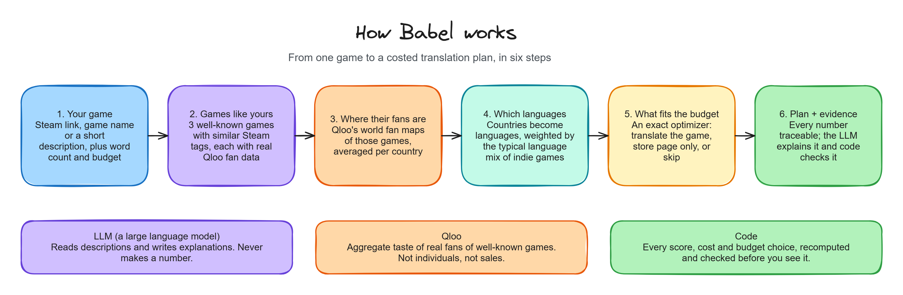
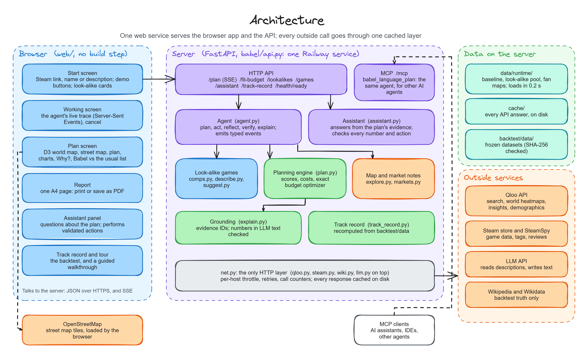
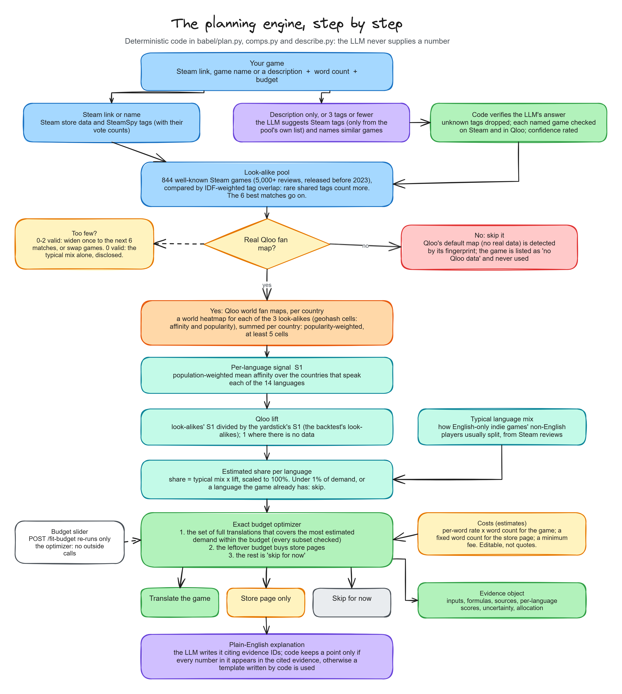
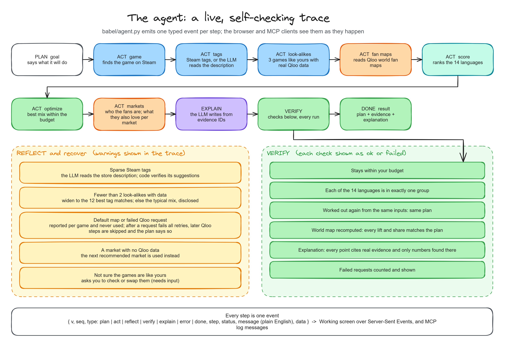
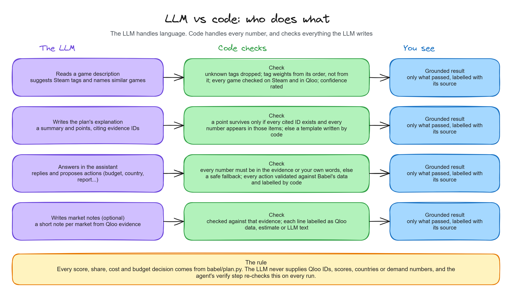
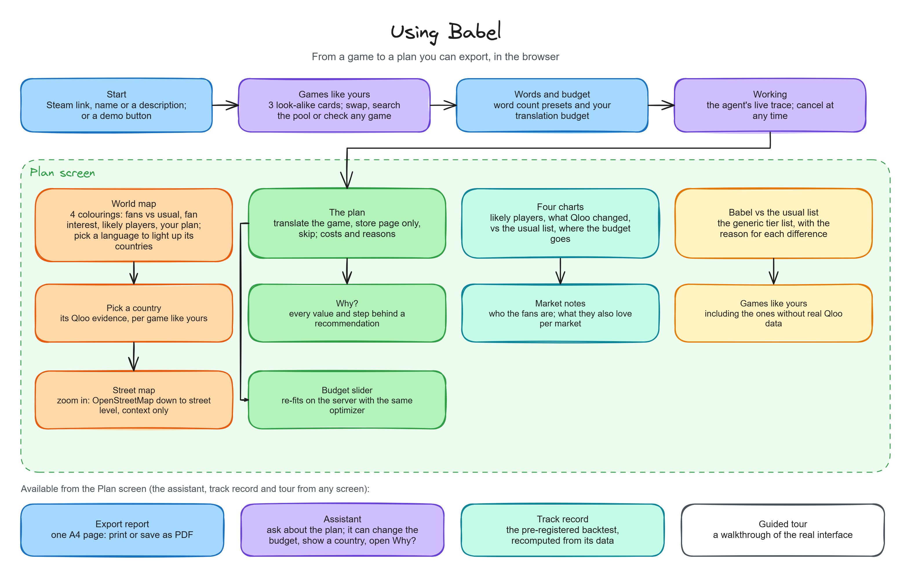
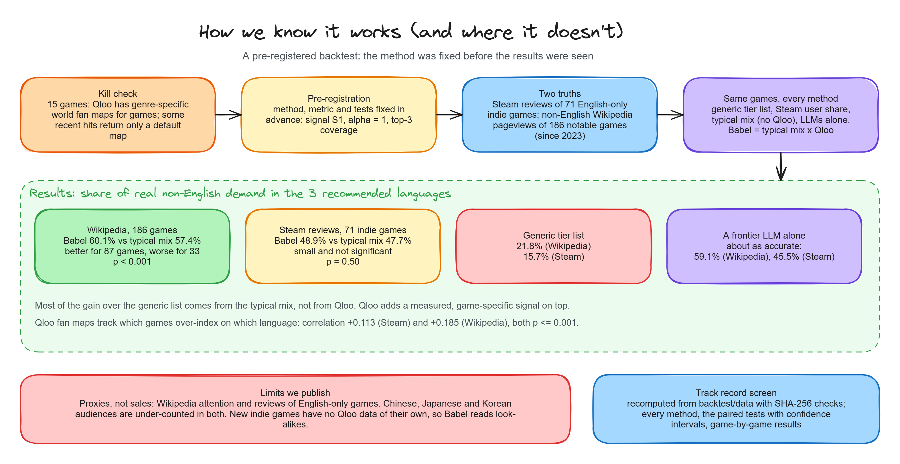
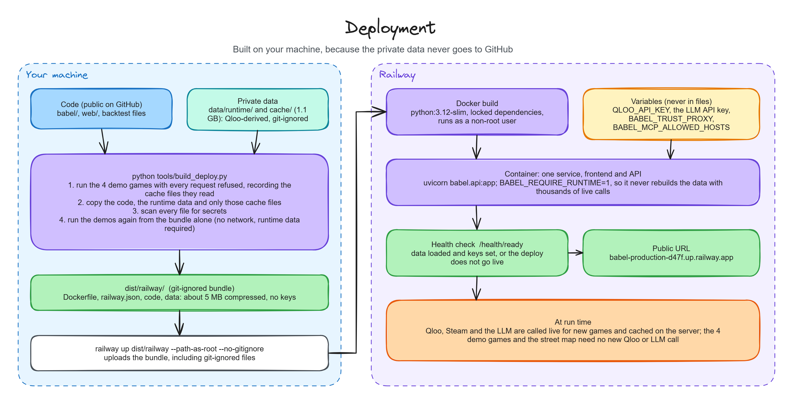

<div align="center">

# Babel

**Which languages should you translate your indie game into?**

Babel answers with a costed plan made for *your* game, not the copy-pasted tier list everyone uses.

[**Live demo**](https://babel-production-d47f.up.railway.app/) ·
[How it works](#how-it-works) ·
[Evidence](#evidence) ·
[Quick start](#quick-start) ·
[API](#http-api) ·
[MCP](#use-babel-from-another-ai-agent-mcp)


*An entry for the Qloo Agentic Hackathon 2026: "Agents, but with taste."*

</div>

---

## Contents

1. [The problem](#the-problem)
2. [What Babel does](#what-babel-does)
3. [How it works](#how-it-works)
   - [Architecture](#architecture)
   - [The planning engine](#the-planning-engine)
   - [The agent](#the-agent)
   - [LLM vs code: who does what](#llm-vs-code-who-does-what)
4. [Using Babel](#using-babel)
5. [Evidence](#evidence)
6. [Quick start](#quick-start)
7. [HTTP API](#http-api)
8. [Use Babel from another AI agent (MCP)](#use-babel-from-another-ai-agent-mcp)
9. [Command line](#command-line)
10. [Deployment](#deployment)
11. [Reproduce the evidence](#reproduce-the-evidence)
12. [Repository layout](#repository-layout)
13. [Security](#security) · [License](#license)

---

## The problem

An indie developer usually has a few thousand dollars for translation. Translating a game costs from about $500 to
more than $20,000 per language, so they can afford two or three languages.

Almost everyone copies the same generic tier list (Simplified Chinese, Japanese and Korean first, then Brazilian
Portuguese, Russian, Spanish...) whatever kind of game they made. A cozy farming game and a war strategy game get the
same advice, although their fans live in different places.

## What Babel does

| | |
|---|---|
| **Input** | A Steam store link, a game name or a short description (for games with no store page yet), plus the game's word count and the translation budget |
| **Output** | Each of 14 languages in one of three groups: **translate the whole game**, **store page only**, or **skip for now**, each with its estimated cost and reason |
| **Also** | A world map of where fans of games like yours are, who those fans are, market notes, the plan in four charts, a comparison with the generic list, and a **Why?** behind every number |
| **Proof** | A [pre-registered backtest](#evidence) on 257 real games, shown in the app's Track record screen |

<p align="center"></p>

A new game has no fans yet, so Qloo has no data on it. Babel finds three **well-known games like yours** (by Steam tag
overlap), reads **Qloo's world fan maps** for them, turns countries into languages, combines that with the **typical
language mix** of games like yours, and fits the result to your budget. The LLM (large language model) only reads and
writes text: **every number comes from code.**

---

## How it works

### Architecture

One web service serves both the browser app and the API. Every call to the outside world goes through one throttled,
cached HTTP layer, so a repeated request never costs a second call.

<p align="center"></p>

| Layer | What it is |
|---|---|
| **Browser** (`web/`) | Plain HTML, CSS and JavaScript, no build step and no keys. D3 draws the world map; the street map uses OpenStreetMap tiles |
| **Server** (`babel/api.py`) | FastAPI: the HTTP API, Server-Sent Events for the live trace, and the MCP endpoint at `/mcp` |
| **Agent** (`babel/agent.py`) | Runs the steps, recovers from problems, verifies the result, and reports every step as a typed event |
| **Engine** (`babel/plan.py`) | Scoring, costs and the exact budget optimizer: pure, deterministic functions |
| **Data** | `data/runtime/` (precomputed look-alike pool and fan maps, loads in 0.2 s), `cache/` (every API answer), `backtest/data/` (frozen datasets) |
| **Outside services** | Qloo (fan maps, insights, demographics), Steam and SteamSpy, the LLM API, and Wikipedia/Wikidata (backtest only) |

### The planning engine

Step by step, from a game to a plan. Everything below is deterministic code; the LLM only appears where it suggests
tags for a description and where it writes the explanation, and code checks both.

<p align="center"></p>

<details>
<summary><b>The formulas</b></summary>

For each of the 14 languages *L* and each look-alike game *c*:

| Quantity | Definition |
|---|---|
| Country profile | Qloo world heatmap cells summed per country, popularity-weighted, at least 5 cells per country |
| **S1(c, L)** | Population-weighted mean Qloo affinity over the countries that speak *L* |
| **lift(L)** | Mean of S1 over the look-alikes ÷ mean of S1 over the yardstick (the Steam backtest's look-alikes); 1 where there is no data |
| **share(L)** | typical mix(L) × lift(L)<sup>α</sup>, scaled to sum to 100%, with α = 1 (chosen on the backtest's development games) |
| Skip rule | Languages under 1% of estimated demand, and languages the game already supports |
| Costs | Per-word rate × word count for the game; a fixed word count for the store page; a minimum fee. Editable, illustrative estimates, not quotes (`Rates` in `babel/plan.py`) |
| Optimizer | An exact 0/1 knapsack: the set of full translations that covers the most estimated demand within the budget (every subset is checked); the leftover budget buys store pages |

If a look-alike has no real Qloo map (Qloo returns one identical *default* map when it has no data, detected by its
fingerprint), it is skipped and never averaged in. With no valid look-alikes at all, the plan is the typical mix alone,
and it says so.

</details>

### The agent

The agent runs the steps above as a live, self-checking trace. It reflects on what comes back, recovers where it can,
and verifies the finished plan before you see it.

<p align="center"></p>

Every step is one event, `{v, seq, type, step, status, message, data}`, with `type` one of `plan`, `act`, `reflect`,
`verify`, `explain`, `error` or `done`. The browser shows them live over Server-Sent Events; MCP clients receive them
as log messages.

### LLM vs code: who does what

<p align="center"></p>

The LLM never supplies Qloo IDs, scores, countries or demand numbers. When it writes text, code keeps a sentence only
if every number in it can be found in the evidence it cites; otherwise Babel shows a version written by code instead.

---

## Using Babel

<p align="center"></p>

1. **Start.** Paste a Steam link, type a game name, or describe a game with no store page, or press a demo button.
2. **Check the games like yours.** Babel shows its three look-alikes; swap any of them, search the pool, or check any game.
3. **Set the word count and budget,** then run.
4. **Working.** The agent's steps stream in live from the server, with a cancel button.
5. **The Plan screen:**
   - **A world map of where fans of games like yours are**, coloured four ways: *fans compared with usual* (the
     default), *fan interest*, *share of likely players* per language, or *your plan*. Pick a country to see its
     evidence, or a language to light up the countries behind it. Zoom onto a country and its **street map** opens:
     OpenStreetMap tiles down to street level, as context only (Babel's figures are for the whole country).
   - **The plan:** whole-game translations, store pages and languages to skip, each with its estimated share, cost and
     how much the games like yours agree. Move the **budget slider** and the server re-runs the same optimizer.
     **Why?** opens every value and step behind a recommendation.
   - **Four charts:** who your likely players are, what Qloo changed, Babel vs the usual list, and where the budget goes.
   - **Babel vs the usual list,** with the reason for each difference, plus who the fans are, market notes and the limits.
6. **Export report:** one A4 page with the inputs, the plan, the map, the games like yours, the explanation, market
   notes and limitations. Print it or save it as a PDF ([sample](docs/samples/report-webfishing.pdf)).

Also available:

- **The Babel assistant** (the logo button on every screen) answers questions about Babel and your open plan, and can
  act for you: plan a game, change the budget, show a country or language, open **Why?**, export the report, start the
  tour. The LLM writes the answers from the plan's evidence; code checks every number and validates every action
  before the browser performs it.
- **Take the tour** walks through the real interface, running the WEBFISHING demo for real from the cache.
- **Track record** shows the backtest, loaded from `backtest/data` (never retyped).
- **Light and dark themes.** Printed reports always stay light.

Every screen speaks plain language ("games like yours", "Qloo adjustment: +16%"); the exact figures (lift ratios,
p-values, confidence intervals, Qloo request IDs) are one click away. Qloo measures the aggregate taste of many fans,
not what any one player likes, and it cannot promise sales; the page says so next to the map.

### Screenshots

| Start | Live run | Where the fans are | One country |
|---|---|---|---|
|  |  |  |  |

| One language | The plan | Why this recommendation? | vs the generic list |
|---|---|---|---|
|  |  |  |  |

| One-page report | Track record | Guided tour | Assistant |
|---|---|---|---|
|  |  |  |  |

| Start, dark theme | The map, dark theme |
|---|---|
|  |  |

---

## Evidence

The method was fixed before the test results were seen ([backtest/PREREGISTRATION.md](backtest/PREREGISTRATION.md)).

<p align="center"></p>

- **186 notable games released since 2023**, measured by non-English Wikipedia pageviews: Qloo fan maps of look-alike
  games improved Babel's top 3 languages. The pick was better for **87 games** and worse for **33** (p < 0.001),
  **+2.7 points** of coverage.
- **71 small English-only indie games**, measured by Steam reviews: the gain was small and **not significant**
  (+1.2 points, p = 0.50). Qloo's signal still tracked which games over-index on which language (p = 0.001).
- **A frontier LLM on its own was about as accurate**, and its game-specific signal was stronger. Babel uses the LLM to
  read and explain, and Qloo for the inspectable evidence. Whether combining them beats both has not been tested.

Top-3 coverage: the share of a game's real non-English demand that falls in the 3 recommended languages.

| Method | Steam reviews (71 indie games) | Wikipedia pageviews (186 notable games) |
|---|---:|---:|
| Generic tier list | 15.7% | 21.8% |
| Steam user share | 47.5% | 51.2% |
| Typical mix (no Qloo) | 47.7% | 57.4% |
| Open-weight LLM alone | 24.3% | 27.4% |
| Frontier LLM alone | 45.5% | 59.1% |
| **Babel = typical mix × Qloo fan maps** | **48.9%** | **60.1%** |

> **Limits.** These are proxies, not sales: attention on Wikipedia, and reviews of English-only games. Chinese,
> Japanese and Korean audiences are under-counted in both. Most of the gap between Babel and the generic list comes
> from the data-driven typical mix, not from Qloo. New indie games have no Qloo taste data of their own (75 of 75
> checked), which is why Babel reads look-alikes. Babel never predicts sales, revenue or return on investment.

Full results, including where Qloo adds little: [backtest/final_report.md](backtest/final_report.md). What we do and do
not claim: [docs/DECISIONS.md](docs/DECISIONS.md).

---

## Quick start

**Requirements:** Python 3.12 and git, plus API keys:

| Key | Needed for |
|---|---|
| `QLOO_API_KEY` | Qloo (the hackathon key). Required |
| `ANTHROPIC_API_KEY` | The LLM (Anthropic API). Required for description input, explanations and the assistant |
| `GROQ_API_KEY` | Only to re-run one backtest competitor (an open-weight LLM) |

<details open>
<summary><b>Windows (PowerShell)</b></summary>

```powershell
git clone https://github.com/Maheswar-Sah00/babel.git; cd babel
python -m venv .venv
.venv\Scripts\Activate.ps1
pip install -r requirements.txt
Copy-Item .env.example .env   # then put your keys in .env
```

</details>

<details>
<summary><b>macOS / Linux</b></summary>

```bash
git clone https://github.com/Maheswar-Sah00/babel.git && cd babel
python3.12 -m venv .venv && source .venv/bin/activate
pip install -r requirements.txt
cp .env.example .env          # then put your keys in .env
```

</details>

Check the install, then start the app:

```bash
python -c "import babel.qloo, babel.steam, babel.wiki, babel.llm, babel.comps; print('ok')"
uvicorn babel.api:app --host 127.0.0.1 --port 8000     # then open http://127.0.0.1:8000
```

With the API cache in place, build the precomputed runtime data once (about a minute, no network). The planner then
starts in about a second instead of about 30 s:

```bash
python tools/build_runtime.py        # -> data/runtime/ (git-ignored: Qloo-derived, like cache/)
```

On a fresh clone (no cache, no `data/runtime/`) the first run downloads the look-alike pool from Steam and Qloo. That
takes a while; every response is cached in `cache/` after that.

For exact, tested versions of every dependency: `pip install -r requirements.txt -r requirements-dev.txt -c
requirements-lock.txt`.

### Tests

```bash
pip install -r requirements-dev.txt
python -m pytest                                  # engine, API, agent and more
python -m playwright install chromium             # once, for the browser tests
python -m pytest tests/test_web.py                # browser tests (real Chromium, network blocked)
python tools/precache_demos.py --offline          # the 4 demo buttons need no live API call
```

Tests that need the local cache (`tests/test_plan_backtest.py`, `tests/test_journey.py`) are skipped without it.

---

## HTTP API

```bash
uvicorn babel.api:app --host 127.0.0.1 --port 8000     # interactive docs at http://127.0.0.1:8000/docs
curl localhost:8000/health/ready                       # 200 once the runtime data is loaded
curl -N -X POST localhost:8000/plan -H "Content-Type: application/json" \
  -d '{"steam_url": "https://store.steampowered.com/app/3146520/", "word_count": 30000, "budget": 10000}'
```

| Endpoint | What it does |
|---|---|
| `POST /plan` | Runs the agent and streams its events as Server-Sent Events: `meta`, the agent's events, then `result`. Use `?stream=false` for one JSON response. Body: one game (`steam_url`, `appid`, `name` or `description`), `word_count`, `budget` and optional `lookalikes` (Steam app IDs) |
| `GET /plans/{plan_id}` | A finished plan from the server's in-memory cache |
| `POST /fit-budget` | A finished plan re-fitted to a new budget with the engine's own optimizer (no outside calls) |
| `POST /lookalikes` | The games like yours the plan would use, alternatives to swap in, and the games checked but rejected |
| `GET /games/search?q=` | Well-known games in the look-alike pool whose name matches |
| `GET /games/{appid}` | One game's Steam data, and whether Qloo has a real fan map for it |
| `POST /assistant` | The in-app assistant: a reply written by the LLM from the plan's evidence (every number checked by code, else a safe fallback) and validated app actions |
| `GET /track-record` | The pre-registered backtest, recomputed from `backtest/data` with file hashes. `?games=false` for the summary only |
| `GET /health`, `GET /health/ready` | Liveness, and readiness (data loaded; keys configured, reported yes/no only) |

Settings (CORS, rate limits, timeouts, body size) come from `BABEL_*` environment variables; see
[.env.example](.env.example). Keys stay on the server, and errors never include stack traces.

---

## Use Babel from another AI agent (MCP)

Babel is an MCP tool, `babel_language_plan`, built with the official Python MCP SDK. It takes `steam_url` (or `appid`,
`name`, `description`), `word_count`, `budget` and optional `lookalikes`, and returns the same plan as `POST /plan`,
plus a summary, market notes, caveats and provenance. Each agent step arrives as an MCP log message.

- **Streamable HTTP:** the MCP endpoint is `/mcp` on the running API (locally `http://127.0.0.1:8000/mcp`). When
  deployed, set `BABEL_MCP_ALLOWED_HOSTS` to the public host name; other Host headers are refused.
- **stdio:** an MCP client starts `python -m babel.mcp_server` itself:

```json
{"mcpServers": {"babel": {"command": "python", "args": ["-m", "babel.mcp_server"],
                          "env": {"PYTHONPATH": "/path/to/babel"}}}}
```

Check either transport with the official MCP client:

```bash
python tools/mcp_demo.py --http http://127.0.0.1:8000/mcp --steam-url https://store.steampowered.com/app/3146520/ --words 30000 --budget 10000
python tools/mcp_demo.py --stdio --appid 2693730 --words 200000 --budget 40000
```

---

## Command line

<details>
<summary><b>Run the agent</b> (live trace)</summary>

```bash
python -m babel.agent --examples                                   # live trace for three demo games
python -m babel.agent --appid 3146520 --words 30000 --budget 10000 # any Steam game (also --name, --description)
python -m babel.agent --examples --jsonl                           # the raw events, as the API streams them
```

</details>

<details>
<summary><b>Plan a game</b> (the engine directly)</summary>

```bash
python -m babel.plan --examples                                   # three example games
python -m babel.plan --appid 3146520 --words 30000 --budget 10000 # a Steam game
python -m babel.plan --name "Dawnsbury Days" --words 200000 --budget 40000
python -m babel.plan --lookalikes 413150,1135690 --words 30000 --budget 8000   # no store page yet: pick look-alikes
python -m babel.plan --tags "Farming Sim,Life Sim,Cozy" --words 40000 --budget 12000
python -m babel.plan --description "A cozy pixel-art farming and fishing game on a small island..." --words 40000 --budget 12000
python -m babel.plan --description-examples                      # three example descriptions
```

Add `--json` for the full evidence object (inputs, formulas, sources, per-language scores, costs, reasons,
uncertainty) and `--markets` for market notes: the look-alikes' audience (Qloo demographics) and, for the top
markets, the films and music popular there that fans of similar games also love. Each line is labelled as Qloo data,
an external observation, a Babel estimate or LLM text.

From a description, the LLM picks Steam tags (only from the look-alike pool's own tags) and names candidate games.
Code checks every name against Steam and Qloo, chooses look-alikes by tag overlap, and rates its confidence; when the
evidence is weak, the plan says so and asks you to choose look-alikes (`--lookalikes`).

</details>

---

## Deployment

Babel runs as one service on [Railway](https://railway.com): the same container serves the web app and the API. The
server needs private, Qloo-derived data that never goes to GitHub, so it is deployed from a bundle built on your
machine.

<p align="center"></p>

```bash
python tools/build_deploy.py        # -> dist/railway/ (git-ignored): code, runtime data, the demos' cache; checked
npm install -g @railway/cli         # once
railway login                       # once, in your browser
railway link                        # once: pick the project and service
railway up dist/railway --path-as-root --no-gitignore
```

- `build_deploy.py` records the cache files the four demo buttons read, copies only those, scans the bundle for
  secrets, and runs every demo from the bundle with all network requests refused.
- The bundle holds no keys. Set them in the Railway service's **Variables** (`QLOO_API_KEY`, `ANTHROPIC_API_KEY`),
  with `BABEL_TRUST_PROXY=1` and `BABEL_MCP_ALLOWED_HOSTS` set to the public host name.
- [deploy/Dockerfile](deploy/Dockerfile) sets `BABEL_REQUIRE_RUNTIME=1`: a server without its runtime data reports
  "not ready" instead of rebuilding it with thousands of live requests. Use `/health/ready` as the health check.

---

## Reproduce the evidence

The frozen datasets are committed in `backtest/data/`, so the evaluation can be re-run directly:

```bash
python backtest/compare.py           # 43-game development run -> backtest/step3_report.md
python backtest/evaluate.py          # -> backtest/final_report.md (Qloo, both LLMs: about $1 of LLM calls)
python backtest/market_insights.py   # -> backtest/market_insights.md
```

To rebuild everything from scratch, run these first. They take several hours on a fresh machine, because Steam and
Wikipedia allow about one request per second:

```bash
python killcheck/killcheck.py        # Qloo kill check -> killcheck/report.md
python backtest/build_dataset.py     # Steam set -> backtest/data/test_games.csv, truth_reviews.csv, comps.csv
python backtest/build_wiki_set.py    # Wikipedia set -> backtest/data/wiki_games.csv, truth_wiki.csv
```

Every API response is cached in `cache/` (git-ignored), so re-runs are offline. Steam, Wikipedia and Qloo data change
over time, and LLM answers vary, so fresh rebuilds can differ slightly from the committed results.

---

## Repository layout

| Path | What it is |
|---|---|
| `babel/` | The engine (`plan.py`), the agent, the API, the MCP server, and throttled, cached clients for Qloo, Steam, Wikipedia and the LLMs |
| `web/` | The browser app: Start, Working and Plan screens, report, track record, tour and assistant (plain HTML, CSS and JavaScript; D3 for the map) |
| `tests/` | Engine, API, agent and browser tests (`python -m pytest`) |
| `backtest/` | Pre-registered backtest: dataset builders, evaluation, reports, frozen data |
| `killcheck/` | Day-1 kill check: does Qloo have genre-specific world fan maps for games? |
| `tools/` | Runtime data, deployment bundle, demo check, map outlines, screenshots, secret scan |
| `deploy/` | Dockerfile and Railway config for the deployment bundle |
| `docs/` | Project brief, decision record, screenshots and the diagrams in this README |

The diagrams are Excalidraw files: open any `docs/diagrams/*.excalidraw` at [excalidraw.com](https://excalidraw.com)
to edit it, then export it as PNG over the matching image.

## Security

API keys live only in `.env` locally (git-ignored) and in the host's environment variables when deployed. Never
commit, print or paste them. Before publishing, run `python tools/check_secrets.py`; it must print `OK`.

## License

[MIT](LICENSE)
