# Babel

**Which languages should you translate your indie game into?** Babel answers with a costed plan made for your game,
not the copy-pasted tier list everyone uses. It reads [Qloo](https://www.qloo.com)'s world fan maps for well-known
games like yours, combines them with the typical language mix of games like it, and shows the evidence behind every
pick.

An entry for the Qloo Agentic Hackathon 2026. **Status: work in progress.** The evidence (backtest) is done; the
agent, API and web app are being built.

## What it does

- **Input:** a Steam store link, a game name or a short description, plus word count and translation budget.
- **Output:**
  - every language in one of three groups: *translate the whole game*, *store page only* or *skip for now*, with
    estimated cost;
  - a world map of where fans of games like this are;
  - the audience profile;
  - a comparison with the generic list.
- **How:** a new game has no fans yet, so Babel finds look-alike games by Steam tag overlap and reads Qloo's fan maps
  for them. Claude reads the game and writes the explanation. All numbers come from code, never from the language
  model.

## Evidence so far

The method was fixed before the test results were seen ([backtest/PREREGISTRATION.md](backtest/PREREGISTRATION.md)).

- **186 notable games released since 2023**, measured by non-English Wikipedia pageviews: adding Qloo fan maps
  improved Babel's top 3 languages over the same method without Qloo. The pick was better for 87 games and worse for
  33 (p < 0.001).
- **71 small English-only indie games**, measured by Steam reviews: the gain was small and not significant.
- **Claude Opus 5.5 alone** was about as accurate as Babel.

Full results, including where Qloo adds little: [backtest/final_report.md](backtest/final_report.md). What we do and
do not claim: [docs/DECISIONS.md](docs/DECISIONS.md).

## Setup

You need Python 3.12 and git, plus API keys: Qloo (hackathon key), Anthropic, and Groq (only for re-running one
backtest competitor).

Windows (PowerShell):

```powershell
git clone <repo-url> babel; cd babel
python -m venv .venv
.venv\Scripts\Activate.ps1
pip install -r requirements.txt
Copy-Item .env.example .env   # then put your keys in .env
```

macOS / Linux:

```bash
git clone <repo-url> babel && cd babel
python3.12 -m venv .venv && source .venv/bin/activate
pip install -r requirements.txt
cp .env.example .env          # then put your keys in .env
```

Check the install:

```bash
python -c "import babel.qloo, babel.steam, babel.wiki, babel.llm, babel.comps; print('ok')"
```

With the API cache in place, build the precomputed runtime data once (about a minute, no network). The planner then
starts in about a second instead of about 30 s:

```bash
python tools/build_runtime.py        # -> data/runtime/ (git-ignored: Qloo-derived, like cache/)
```

Without it (or when it is out of date) the planner builds the same data from the cache at startup.

## Use it in the browser

```bash
uvicorn babel.api:app --host 127.0.0.1 --port 8000     # then open http://127.0.0.1:8000
```

The Start screen sits on a dot-matrix world map (Natural Earth 1:50m outlines, every continent whole, small islands
included): each of the 14 languages Babel plans for is pinned, in its own script, on a country where it is spoken,
with Hindi and seven African languages too (Arabic, Hausa, Amharic, Swahili, Lingala, Somali, Zulu), which Babel does
not plan for; the countries where they are spoken are lit. It is decoration, not data. The moon button in the nav switches to a dark theme (black and greys, no blue), which
spreads in a circle from where you click; the default follows your system setting, and printed reports stay light.

The flow:

1. Paste a Steam link, type a game name, or describe a game without a store page.
2. Check the three games like yours that Babel found (its look-alikes), and swap any of them.
3. Set the word count and budget, then run.

The Working screen streams every step the agent takes from the server, with a cancel button. Then the Plan screen
opens:

- **A world map of where fans of games like yours are**, from their Qloo fan maps. You can colour it four ways:
  - *fans compared with usual* (the default: fan affinity vs typical games);
  - *fan interest* (raw affinity);
  - *share of likely players* per language (estimated demand);
  - *your plan*.

  Zoom, pan, search for a country, or pick one to see its evidence; pick a language to light up the countries behind
  it. Zoom onto a country (pick it from the list or search, or scroll or zoom in on it until it fills the view) and its street
  map opens: [OpenStreetMap](https://www.openstreetmap.org/copyright) tiles down to street level, under the country's
  outline in its map colour. It is context only: Babel's figures are for the whole country. The tiles load from
  `tile.openstreetmap.org` in the browser (the only map request that leaves the site; it sends the site's origin, as
  OSM's tile policy asks); zoom out past the country, or press **World**, to go back.
- **The plan**: whole-game translations, store pages and languages to skip, each with its estimated share, cost and
  how much the comparable games agree. Move the budget and the server re-runs the same optimizer. **Why?** opens every
  value and step behind a recommendation.
- **The plan in four charts**: who your likely players are, what Qloo changed, Babel vs the usual list, and where the
  budget goes.
- **Babel vs the usual list** (the generic tier list), with the reason for each difference, plus the games like
  yours (including the ones Qloo has no real data for), who the fans are, market notes and the limits.

Qloo measures aggregate cultural affinity, not individual preferences or guaranteed sales; the page says so next to
the map, in plain words.

Every screen speaks plain language ("games like yours", "Qloo adjustment: +16%", "too small a difference to rule out
luck"); the exact figures (lift ratios, ranges, p-values, confidence intervals, Qloo request ids) are one click away
in **Why?** and the "exact numbers" sections. The API and the MCP tool return the precise fields.

**Export report** turns the open plan into a one-page A4 report: inputs, the plan with costs and reasons, the map,
the comparable games and their Qloo status, the explanation, market notes and limitations. Print it or save it as a
PDF from the browser's print dialog ([sample](docs/samples/report-webfishing.pdf)).

**The Babel assistant** (the logo button at the side of every screen) answers questions about Babel and your open
plan, and can act for you: plan a game, change the budget, show a country or a language on the map, open "Why?",
export the report, start the tour. Claude writes the answers from the plan's evidence; code checks every number in
them (an answer with a number it cannot find is withheld) and validates every action before the browser performs it.
Each message is one Claude call (identical questions come from the cache).

**Take the tour** (in the nav) walks through the whole product on the real interface: it runs the WEBFISHING demo
for real (from the cache) and points out each part, from the comparable games to the track record.

**Track record** shows the pre-registered backtest, loaded from `backtest/data` (never retyped): Steam reviews and
Wikipedia pageviews side by side, every method on the same games, the paired tests with their confidence intervals,
game-by-game predicted vs observed shares, how to read the numbers and what the measures miss.

The web app is plain HTML, CSS and JavaScript in `web/`, served by the same FastAPI app: no build step, and no keys in
the browser. The map uses D3 (vendored in `web/static/vendor/`) and Natural Earth country outlines
(`web/static/world.json`, built by `tools/build_world.py`).

| Start | Live run | Where the fans are | One country |
|---|---|---|---|
| 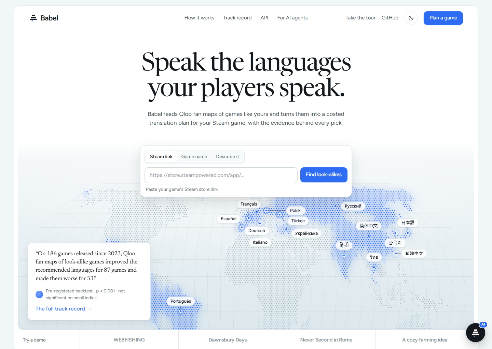 | 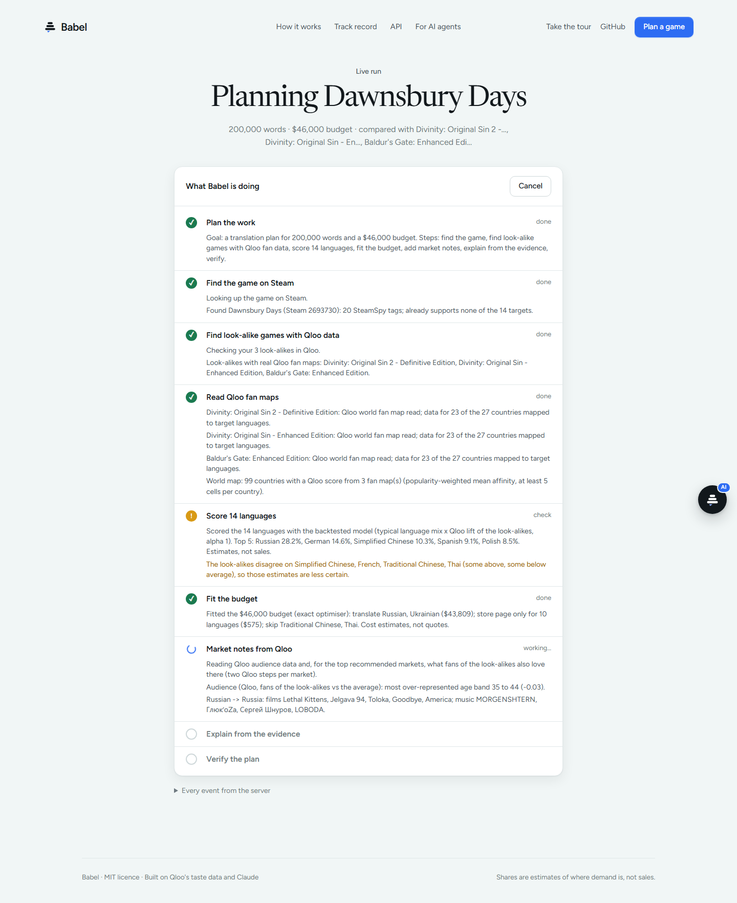 | 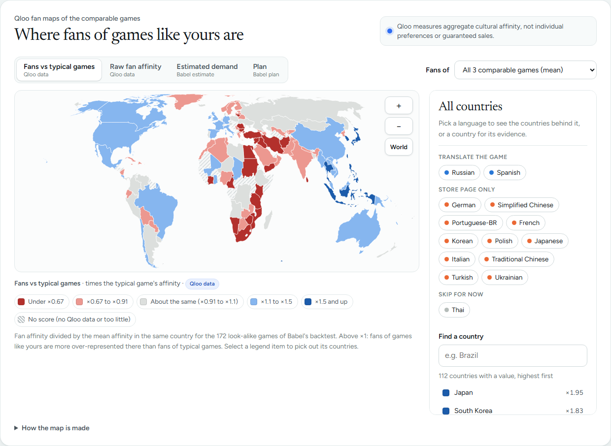 | 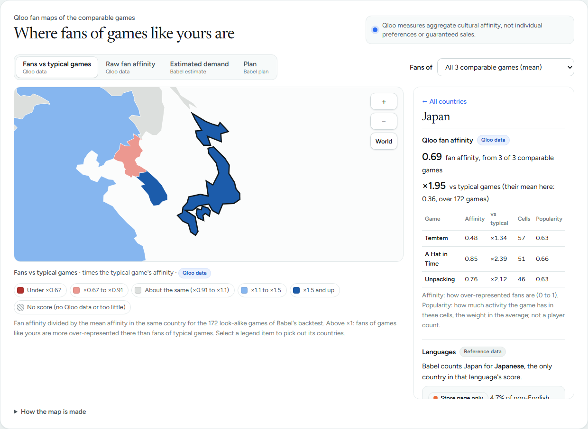 |

| One language | The plan | Why this recommendation? | vs the generic list |
|---|---|---|---|
| 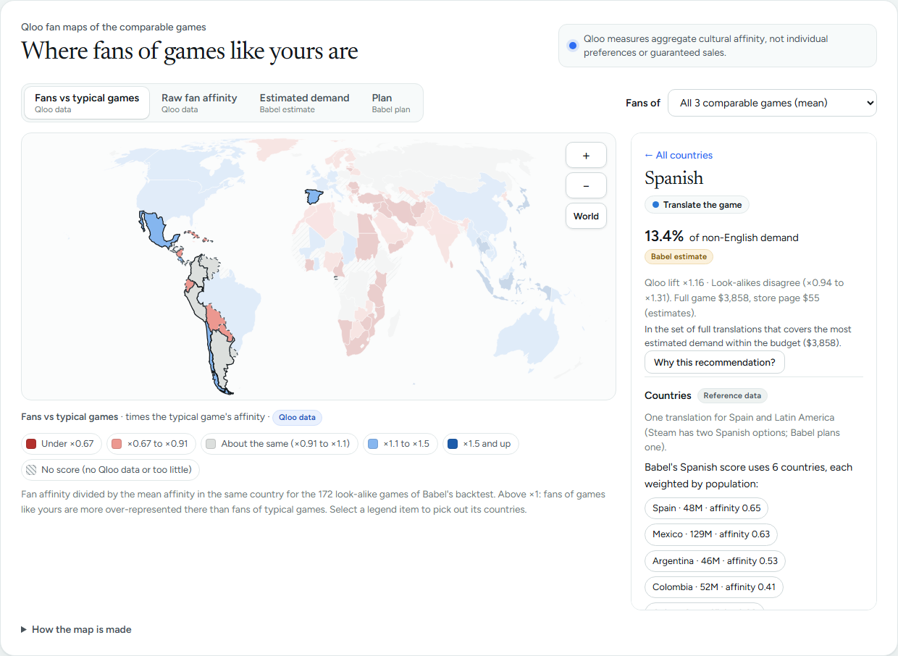 | 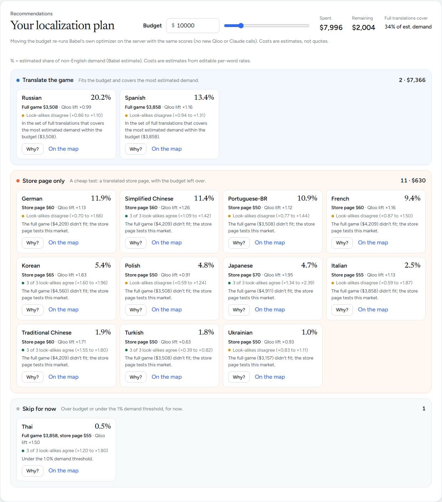 | 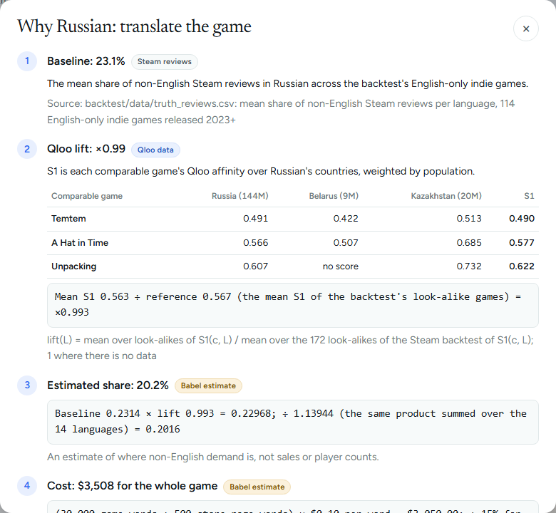 | 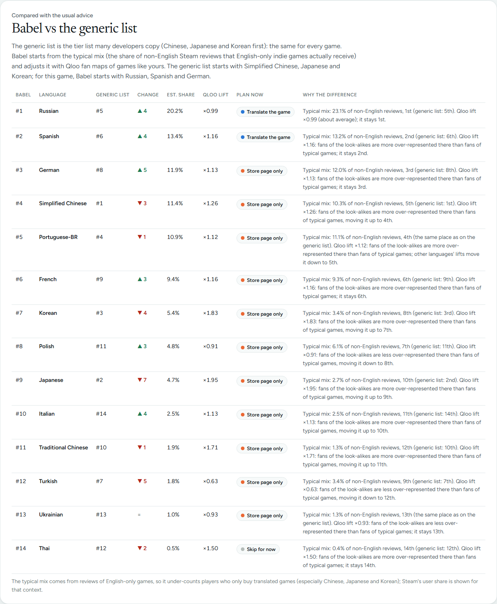 |

| One-page report | Track record | Guided tour | Assistant |
|---|---|---|---|
| 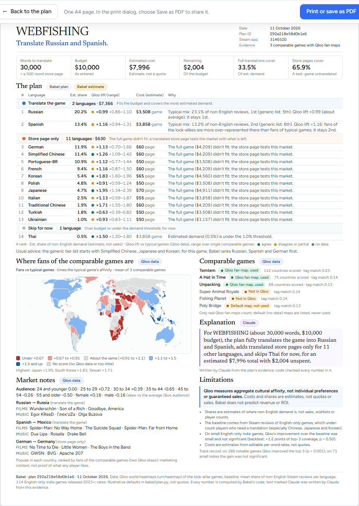 | 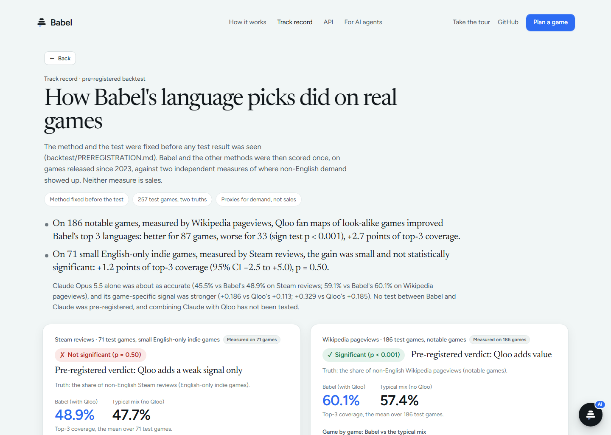 | 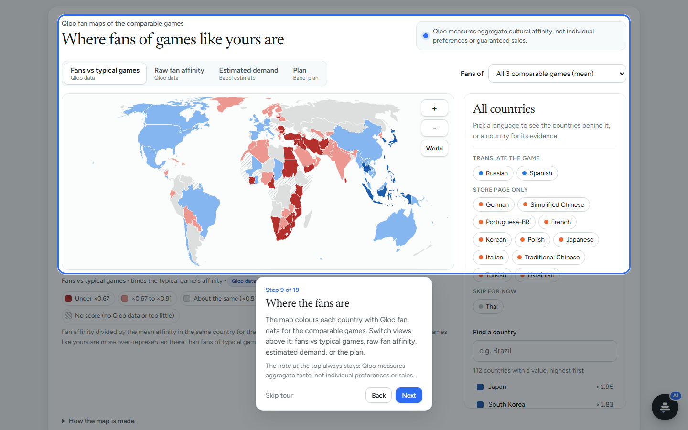 | 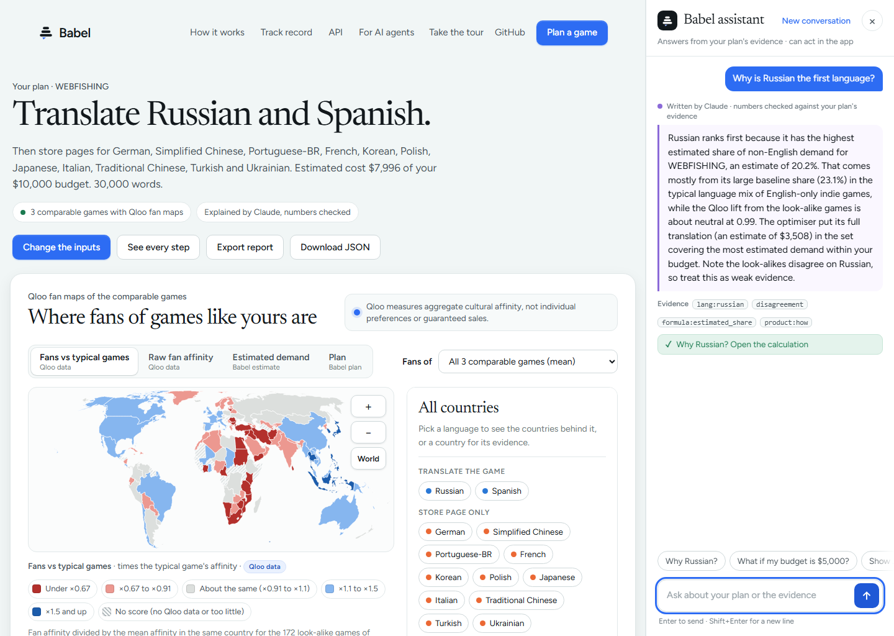 |

| Start, dark theme | The map, dark theme |
|---|---|
| 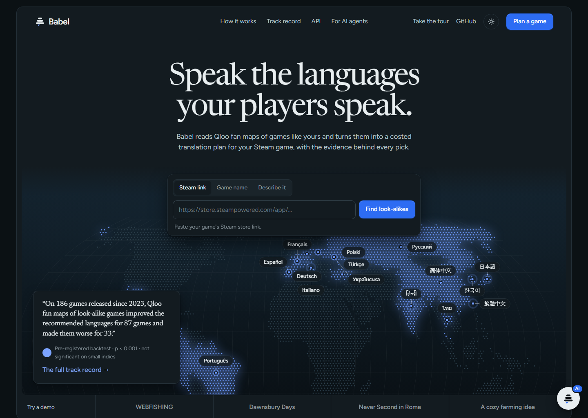 | 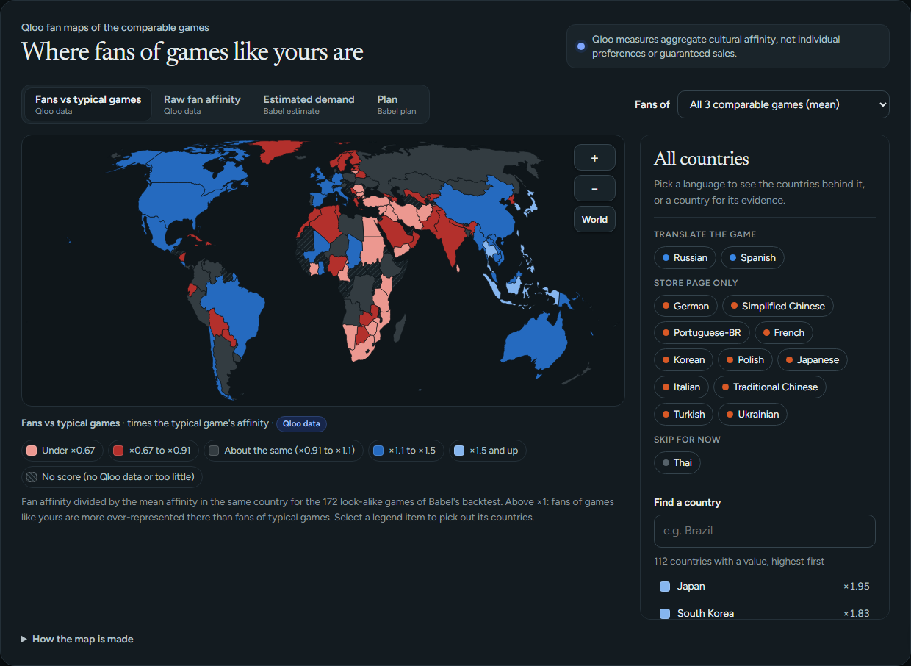 |

Browser tests: `python -m playwright install chromium`, then `python -m pytest tests/test_web.py`. To refresh the
screenshots, run `python tools/screenshots.py` against a running server. `python tools/precache_demos.py --offline`
checks that the four demo buttons run from the cache alone (no live API call).

For exact, tested versions of every dependency: `pip install -r requirements.txt -r requirements-dev.txt -c
requirements-lock.txt`. Local release check: [docs/LOCAL_RELEASE_READINESS.md](docs/LOCAL_RELEASE_READINESS.md).

## Run the API

```bash
uvicorn babel.api:app --host 127.0.0.1 --port 8000     # docs at http://127.0.0.1:8000/docs
curl localhost:8000/health/ready                       # 200 once the runtime data is loaded
curl -N -X POST localhost:8000/plan -H "Content-Type: application/json" \
  -d '{"steam_url": "https://store.steampowered.com/app/3146520/", "word_count": 30000, "budget": 10000}'
```

| Endpoint | What it does |
|---|---|
| `POST /plan` | Runs the agent and streams its events as Server-Sent Events: `meta`, then the agent's events (`plan`, `act`, `reflect`, `verify`, `explain`, `error`, `done`), then `result`. Use `?stream=false` for one JSON response. The body takes one game (`steam_url`, `appid`, `name` or `description`), plus `word_count`, `budget` and optional `lookalikes` (Steam app IDs). |
| `GET /plans/{plan_id}` | A finished plan from the server's in-memory cache. |
| `POST /fit-budget` | A finished plan re-fitted to a new budget: send the plan's `allocation` object and a `budget`, get the groups, reasons, costs and coverage the engine's own optimizer gives (no external calls). |
| `POST /lookalikes` | For one game (`steam_url`, `appid`, `name` or `description`): the comparable games the plan would use, alternatives to swap in, and the games that were checked but rejected. |
| `GET /games/search?q=` | Well-known games in the look-alike pool whose name matches. |
| `GET /games/{appid}` | One game's Steam data, and whether Qloo has a real fan map for it. |
| `POST /assistant` | The in-app assistant: `messages` plus the screen's `context` (open `plan_id`, budget, view). Returns a reply written by Claude from the plan's evidence (every number checked by code, else a safe fallback) and validated app actions for the browser to perform. |
| `GET /track-record` | The pre-registered backtest results, recomputed from `backtest/data` with file hashes (every method's metrics, the paired tests with bootstrap intervals, per-game observed shares and rankings). Add `?games=false` for the summary only. |
| `GET /health`, `GET /health/ready` | Liveness, and readiness (data loaded; keys configured, reported yes/no only). |

Settings (CORS, rate limits, timeouts, body size) come from `BABEL_*` environment variables; see `.env.example`.
Keys stay on the server, and errors never include stack traces.

## Use Babel from another AI agent (MCP)

Babel is an MCP tool, `babel_language_plan`, built with the official Python MCP SDK. It takes `steam_url` (or
`appid`, `name`, `description`), `word_count`, `budget` and optional `lookalikes`. It returns the same plan as
`POST /plan`, plus a summary, market notes, caveats and provenance; each agent step arrives as an MCP log message.

- **Streamable HTTP**: start the API (above); the MCP endpoint is `http://127.0.0.1:8000/mcp`. When deployed, set
  `BABEL_MCP_ALLOWED_HOSTS` to the public host name (other Host headers are refused).
- **stdio**: an MCP client starts `python -m babel.mcp_server` itself. Example client configuration:

```json
{"mcpServers": {"babel": {"command": "python", "args": ["-m", "babel.mcp_server"],
                          "env": {"PYTHONPATH": "/path/to/babel"}}}}
```

Check either transport with the official MCP client:

```bash
python tools/mcp_demo.py --http http://127.0.0.1:8000/mcp --steam-url https://store.steampowered.com/app/3146520/ --words 30000 --budget 10000
python tools/mcp_demo.py --stdio --appid 2693730 --words 200000 --budget 40000
```

## Run the agent

```bash
python -m babel.agent --examples                                   # live trace for three demo games
python -m babel.agent --appid 3146520 --words 30000 --budget 10000 # any Steam game (also --name, --description)
```

The agent prints each step as it happens:
- **plan:** what it will do;
- **act:** Steam, Qloo, Claude and the planning engine;
- **reflect:** too few look-alikes, default maps, missing market data, and how it recovers;
- **verify:** the budget is kept, and the plan recomputes identically;
- **explain:** what the plan means.

Claude's explanation must cite evidence IDs, and code checks every number against them. `--jsonl` prints the raw
events, in the stable format the API will stream.

## Plan a game

```bash
python -m babel.plan --examples                                   # three example games
python -m babel.plan --appid 3146520 --words 30000 --budget 10000 # a Steam game
python -m babel.plan --name "Dawnsbury Days" --words 200000 --budget 40000
python -m babel.plan --lookalikes 413150,1135690 --words 30000 --budget 8000   # no store page yet: pick look-alikes
python -m babel.plan --tags "Farming Sim,Life Sim,Cozy" --words 40000 --budget 12000
python -m babel.plan --description "A cozy pixel-art farming and fishing game on a small island..." --words 40000 --budget 12000
python -m babel.plan --description-examples                      # three example descriptions
```

From a description, Claude picks Steam tags (only from the look-alike pool's own tags) and names candidate games. Code
checks every name against Steam and Qloo, chooses look-alikes by tag overlap, and rates its confidence; when the
evidence is weak, the plan says so and asks you to choose look-alikes (`--lookalikes`). Claude never supplies IDs,
scores or demand numbers.

Add `--json` for the full evidence object (inputs, formulas, sources, per-language scores, costs, reasons,
uncertainty), and `--markets` for market notes. These cover the look-alikes' audience (Qloo demographics) and, for
the top recommended markets, the films and music popular there that fans of similar games also love (Qloo, in two
steps). Each line is labelled as measured by Qloo, an external observation, a Babel estimate or a note written by
Claude; Qloo data describes aggregate taste, never an individual player. Costs use editable, illustrative per-word rates (`Rates` in `babel/plan.py`), not quotes.

On a fresh clone (no cache, no `data/runtime/`) the first run downloads the look-alike pool from Steam and Qloo; that takes a while, and every
response is cached in `cache/` after that.

Tests: `pip install -r requirements-dev.txt`, then `python -m pytest`. The tests in `tests/test_plan_backtest.py`
need the local cache and are skipped without it.

## Reproduce the evidence

The frozen datasets are committed in `backtest/data/`, so the evaluation can be re-run directly:

```bash
python backtest/compare.py           # 43-game development run -> backtest/step3_report.md
python backtest/evaluate.py          # -> backtest/final_report.md (Qloo, Groq and about $1 of Claude calls)
python backtest/market_insights.py   # -> backtest/market_insights.md
```

To rebuild everything from scratch, run these first. They take several hours on a fresh machine because Steam and
Wikipedia allow about one request per second.

```bash
python killcheck/killcheck.py        # Qloo kill check -> killcheck/report.md
python backtest/build_dataset.py     # Steam set -> backtest/data/test_games.csv, truth_reviews.csv, comps.csv
python backtest/build_wiki_set.py    # Wikipedia set -> backtest/data/wiki_games.csv, truth_wiki.csv
```

Every API response is cached in `cache/` (git-ignored), so re-runs are offline. Steam, Wikipedia and Qloo data change
over time, and language-model answers vary, so fresh rebuilds can differ slightly from the committed results.

## Repository

| Path | What it is |
|---|---|
| `babel/` | Planning engine (`plan.py`), plus throttled, cached clients for Qloo, Steam, Wikipedia and the LLMs and the look-alike picker |
| `tests/` | Engine tests (`python -m pytest`) |
| `web/` | The browser app: Start, Working and Plan screens (plain HTML, CSS, JavaScript; D3 for the map) |
| `backtest/` | Pre-registered backtest: dataset builders, evaluation, reports, frozen data |
| `killcheck/` | Day-1 kill check: does Qloo have genre-specific world fan maps for games? |
| `docs/` | Project brief and decision record |
| `tools/check_secrets.py` | Pre-publication secret scan (run before every push) |

## Security

API keys live only in `.env`, which is git-ignored. Never commit, print or paste them. Before publishing, run
`python tools/check_secrets.py`; it must print `OK`.

## License

[MIT](LICENSE)
