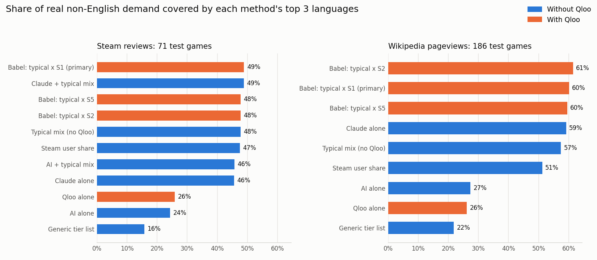

# Babel final backtest

Follows [PREREGISTRATION.md](PREREGISTRATION.md). Coverage = share of the game's real non-English demand that falls in the 3 recommended languages.

## Overall verdict: **Qloo adds value**

- Steam reviews: Qloo adds a weak signal only (Babel +1.18% coverage vs typical mix, p = 0.500).
- Wikipedia pageviews: Qloo adds value (Babel +2.67% coverage vs typical mix, p = 0.000).

## Steam reviews

Dev 43 games, test 71 games (68 with look-alikes). Primary Qloo signal chosen on dev: **S1 (Look-alike fan maps (affinity))**; dev correlations: S1 +0.136, S2 +0.086, S5 +0.047; alpha: S1 1, S2 0, S5 0.

| Competitor | Top-3 coverage (primary) | Top-3 hit | Spearman | Top-3 hit (adjusted) |
|---|---|---|---|---|
| Generic tier list | 15.7% | 15% | 0.33 | 18% |
| Steam user share | 47.5% | 51% | 0.63 | 25% |
| Typical mix (no Qloo) | 47.7% | 54% | 0.77 | 22% |
| AI alone | 24.3% | 26% | 0.47 | 19% |
| AI + typical mix | 45.7% | 48% | 0.69 | 25% |
| Claude alone | 45.5% | 48% | 0.67 | 25% |
| Claude + typical mix | 48.8% | 52% | 0.77 | 27% |
| Qloo alone | 25.9% | 23% | 0.22 | 28% |
| Babel: typical x S1 (primary) | 48.9% | 56% | 0.76 | 25% |
| Babel: typical x S2 | 47.7% | 54% | 0.77 | 22% |
| Babel: typical x S5 | 47.7% | 54% | 0.77 | 22% |

**Primary test, Babel vs typical mix (coverage):** Babel better on 23 games, tie 26, worse 22; one-sided sign test p = 0.500; mean difference +1.18% (95% bootstrap CI -2.46% to +5.00%).

| Signal (test games with look-alikes) | Within-language correlation with real over-index | Shuffle p |
|---|---|---|
| S1: Look-alike fan maps (affinity) | +0.113 | 0.001 |
| S2: Look-alike fan maps (fan mass) | +0.050 | 0.065 |
| S5: Look-alike affinity per country (entity insights) | +0.087 | 0.002 |
| AI alone (its ranking) | +0.027 | 0.213 |
| Claude alone (its ranking) | +0.186 | 0.000 |

**Pre-registered verdict (Steam reviews): Qloo adds a weak signal only.**

## Wikipedia pageviews

Dev 186 games, test 186 games (185 with look-alikes). Primary Qloo signal chosen on dev: **S1 (Look-alike fan maps (affinity))**; dev correlations: S1 +0.186, S2 +0.149, S5 +0.185; alpha: S1 1, S2 1, S5 2.

| Competitor | Top-3 coverage (primary) | Top-3 hit | Spearman | Top-3 hit (adjusted) |
|---|---|---|---|---|
| Generic tier list | 21.8% | 20% | 0.18 | 19% |
| Steam user share | 51.2% | 46% | 0.42 | 28% |
| Typical mix (no Qloo) | 57.4% | 54% | 0.56 | 30% |
| AI alone | 27.4% | 26% | 0.35 | 24% |
| Claude alone | 59.1% | 53% | 0.55 | 44% |
| Qloo alone | 26.1% | 24% | 0.12 | 32% |
| Babel: typical x S1 (primary) | 60.1% | 58% | 0.59 | 34% |
| Babel: typical x S2 | 61.4% | 59% | 0.59 | 35% |
| Babel: typical x S5 | 59.5% | 57% | 0.57 | 32% |

**Primary test, Babel vs typical mix (coverage):** Babel better on 87 games, tie 66, worse 33; one-sided sign test p = 0.000; mean difference +2.67% (95% bootstrap CI +0.06% to +5.42%).

| Signal (test games with look-alikes) | Within-language correlation with real over-index | Shuffle p |
|---|---|---|
| S1: Look-alike fan maps (affinity) | +0.185 | 0.000 |
| S2: Look-alike fan maps (fan mass) | +0.164 | 0.000 |
| S5: Look-alike affinity per country (entity insights) | +0.122 | 0.000 |
| AI alone (its ranking) | +0.112 | 0.000 |
| Claude alone (its ranking) | +0.329 | 0.000 |

**Pre-registered verdict (Wikipedia pageviews): Qloo adds value.**

## Validity check: the game's own Qloo fan map (post-launch, not a competitor)

| Truth | Sampled | Found in Qloo | Default (no-data) map | Real map | Within-language correlation | Shuffle p |
|---|---|---|---|---|---|---|
| Steam reviews | 100 | 75 | 75 | 0 | n/a | n/a |
| Wikipedia pageviews | 100 | 69 | 53 | 16 | +0.180 | 0.002 |

## API usage this run

| Host | Network calls | From cache |
|---|---|---|
| api.anthropic.com | 328 | 0 |
| api.groq.com | 142 | 241 |
| hackathon.api.qloo.com | 272 | 780 |
