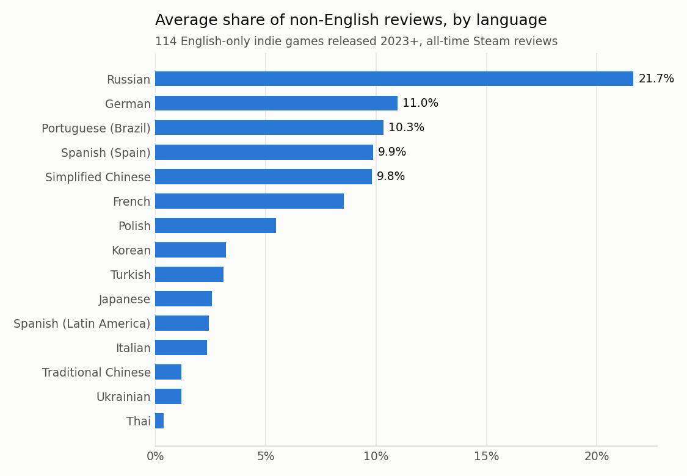

# Step 2: backtest dataset

Files: `data/test_games.csv` (114 games), `data/truth_reviews.csv`, `data/comps.csv` (302 rows), `data/lang_share.png`.

## A. Test games: games left after each filter

| Filter | Games left |
|---|---|
| candidates checked | 4000 |
| Steam store data | 3965 |
| type = game | 3964 |
| English only | 833 |
| released 2023-01-01 or later | 237 |
| not free-to-play | 215 |
| 500+ reviews (Steam, all languages) | 114 |

Candidates: SteamSpy Indie tag with 150+ SteamSpy reviews (11978; SteamSpy lags Steam, so Steam's own count decides the 500 cut), newest store pages first. Scanning stops at 200 games; the first 800 candidates were not enough, so it continued to 4000 and found only 114 (cap 4000).

## B. Ground truth

Sanity check: do the 16 per-language totals add up to the all-language total?

| Game | All languages | Sum of 16 languages | Coverage | Languages equal to total |
|---|---|---|---|---|
| The Deadseat | 674 | 669 | 99.3% | 0 |
| Jacksmith: Weapons and Warriors | 2007 | 1923 | 95.8% | 0 |

Passed: the language filter works (the remainder is languages outside the 16). Median non-English share of reviews: 19%.

| Language | Average share of non-English reviews |
|---|---|
| Russian | 21.7% |
| German | 11.0% |
| Portuguese (Brazil) | 10.3% |
| Spanish (Spain) | 9.9% |
| Simplified Chinese | 9.8% |
| French | 8.5% |
| Polish | 5.5% |
| Korean | 3.2% |
| Turkish | 3.1% |
| Japanese | 2.6% |
| Spanish (Latin America) | 2.4% |
| Italian | 2.3% |
| Traditional Chinese | 1.2% |
| Ukrainian | 1.2% |
| Thai | 0.4% |

## C. Comparable games

Pool: SteamSpy top-owned + Indie games with 5,000+ reviews, the 1000 most reviewed, released before 2023-01-01: 844 games. Ranked by IDF-weighted tag overlap; the top 6 are tried in order until 3 have a valid Qloo heatmap.

- Games with 3 valid comps: **88 / 114** (2: 16, 1: 6, 0: 4)
- Comps checked in Qloo: 285 unique; valid: 173, default map: 46, not in Qloo: 66
- Unique comps used: 173

## D. API usage

| Source | Network calls this run | Served from cache | Responses used |
|---|---|---|---|
| Qloo | 328 | 255 | 583 |
| Steam store | 3392 | 4373 | 7765 |
| SteamSpy | 71 | 1003 | 1074 |
